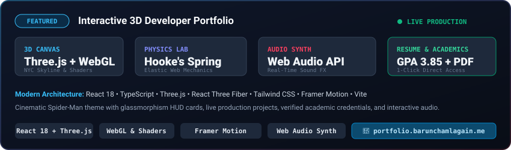
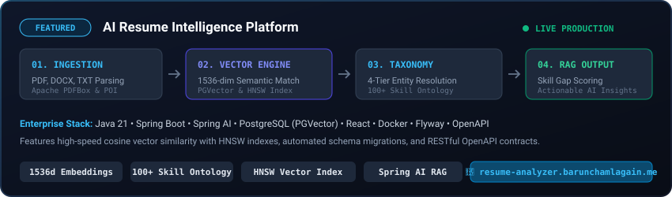
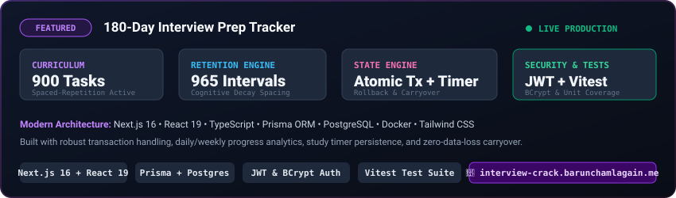
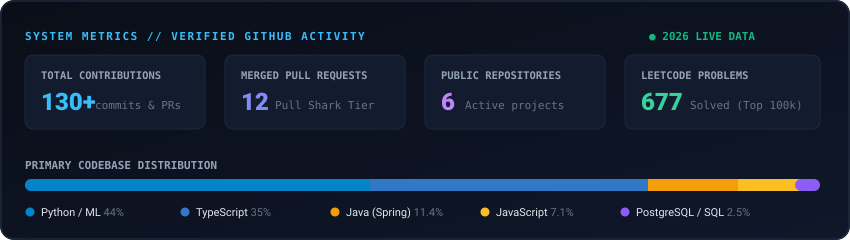

  

  

  

    🎓 <b>B.S. in Computer Science @ University of North Texas</b> (GPA: <b>3.85</b>) &nbsp;|&nbsp; 📍 <b>Keller, Texas, USA</b>
     
    <i>Passionate about engineering scalable full-stack applications, distributed data pipelines, and production AI/ML systems.</i>
  

  

    
    
    
    
    
    
  

 

---

### 🔭 About Me & Core Specialization

I am a Computer Science student at the **University of North Texas** passionate about bridging rigorous backend engineering with intelligent machine learning systems. My engineering foundation spans:

* **Backend Systems**: High-throughput REST architectures in **Java 21** and **Spring Boot**, utilizing **Prisma**, **Flyway migrations**, and transaction isolation.
* **Modern Web**: Responsive applications built on **React 19**, **Next.js 16**, **TypeScript**, and **Tailwind CSS**.
* **AI & Semantic Search**: Production **Retrieval-Augmented Generation (RAG)** pipelines using **Spring AI**, **PGVector**, 1536-dimensional embeddings, and HNSW indexing.
* **Data Engineering**: Robust document ingestion (Apache PDFBox, Apache POI), ETL normalization, and multi-tier entity resolution.

---

### 🌐 Personal Portfolio

> **Interactive 3D Spider-Man-inspired developer portfolio featuring Three.js procedural graphics, custom Web Audio synthesis, Hooke's spring physics, and live project architectures.**

  

* **Live Webpage:** [portfolio.barunchamlagain.me](https://portfolio.barunchamlagain.me/)
* **Repository:** [Barun-Chhetri/Personal_Portfolio](https://github.com/Barun-Chhetri/Personal_Portfolio)
* **Direct Resume (PDF):** [Barun_Chhetri_Resume_2026_Updated.pdf](https://portfolio.barunchamlagain.me/Barun_Chhetri_Resume_2026_Updated.pdf)
* **Core Technologies:** React 18, TypeScript, Three.js, React Three Fiber, Tailwind CSS, Framer Motion, Web Audio API, Vite.
* **Key Architecture & Features:**
  * **Interactive 3D Canvas:** Procedural 3D NYC skyline with rotating searchlights, atmospheric embers, and mouse parallax built in Three.js and WebGL.
  * **Interactive Web-Slinging Physics:** Dynamic physics lab featuring Hooke's spring mechanics, momentum throws, and synthetic Web Audio sound effects.
  * **Production Showcase & Verification:** Direct access to live deployments, verified UNT academic standing, and one-click resume download.

---

### 🚀 Production Systems & Featured Projects

 

#### 1. AI Resume Intelligence Platform
> **Enterprise-grade resume analysis and job matching platform powered by Spring Boot, Spring AI, and vector similarity search.**

  

* **Live Platform:** [resume-analyzer.barunchamlagain.me](https://resume-analyzer.barunchamlagain.me/)
* **Repository:** [Barun-Chhetri/Resume_Analyzer](https://github.com/Barun-Chhetri/Resume_Analyzer)
* **Core Technologies:** Java 21, Spring Boot 3, Spring AI, PostgreSQL, PGVector, React, Docker, Flyway, OpenAPI / Swagger.
* **Key Architecture & Features:**
  * **Document Ingestion Engine:** Parses PDF, DOCX, and TXT files using Apache PDFBox and Apache POI with schema validation.
  * **Vector Semantic Search:** Generates 1536-dimensional embeddings and executes sub-second cosine distance searches via HNSW vector indexes.
  * **4-Tier Entity Resolution:** Maps unstructured candidate terminology against a canonical taxonomy of 100+ verified technical competencies.
  * **Skill Gap Analysis & RAG:** Generates personalized, contextual feedback comparing candidate qualifications directly with targeted job requisitions.
  * **Reliability & Specs:** Managed through Flyway database migrations, containerized with Docker, and documented via OpenAPI specifications.

 

#### 2. 180-Day Interview Prep Tracker
> **High-retention technical interview coaching platform built with Next.js 16, React 19, and cognitive spaced repetition.**

  

* **Live Platform:** [interview-crack.barunchamlagain.me](https://interview-crack.barunchamlagain.me/)
* **Repository:** [Barun-Chhetri/interview-crack-tracker](https://github.com/Barun-Chhetri/interview-crack-tracker)
* **Core Technologies:** Next.js 16 (App Router), React 19, TypeScript, Prisma ORM, PostgreSQL, Docker, Tailwind CSS, Vitest.
* **Key Architecture & Features:**
  * **Comprehensive Curriculum:** 900 structured study tasks and 965 automated spaced-repetition intervals to counter cognitive decay.
  * **State & Time Engine:** Features persistent client-side and server-side study timers, task carryover, and historical audit trails.
  * **Database Concurrency:** Leverages Prisma ORM with atomic database transaction isolation to eliminate race conditions during concurrent checklist updates.
  * **Security & Auth:** Secure session management via JWT tokens, BCrypt salt-hashed passwords, and tokenized password reset pipelines.
  * **Testing & Analytics:** Daily, weekly, and monthly aggregate visual progress charts with unit and integration coverage via Vitest.

---

### 🛠️ Technical Competency & Ecosystem

  

 

<b>💻 Programming Languages</b>

 

| Technology | Primary Use Case | Official Documentation |
| :--- | :--- | :--- |
|  | Enterprise Services, Microservices, RAG backends | [docs.oracle.com/en/java](https://docs.oracle.com/en/java/) |
|  | Machine Learning, Data Processing, Scripting | [docs.python.org](https://docs.python.org/3/) |
|  | Type-Safe Full-Stack & Frontend Applications | [typescriptlang.org](https://www.typescriptlang.org/) |
|  | Modern Web Applications & Interactive UIs | [developer.mozilla.org](https://developer.mozilla.org/en-US/docs/Web/JavaScript) |
|  | Complex Queries, Joins, Indexing, Vector Search | [postgresql.org/docs](https://www.postgresql.org/docs/) |

<b>⚙️ Backend & Systems Architecture</b>

 

| Technology | Specialization | Reference |
| :--- | :--- | :--- |
|  | Production REST APIs, Dependency Injection, Security | [spring.io/projects/spring-boot](https://spring.io/projects/spring-boot) |
|  | AI Orchestration, Prompt Engineering, Model Integration | [spring.io/projects/spring-ai](https://spring.io/projects/spring-ai) |
|  | Stateless HTTP Architecture, Clean Endpoints | [restfulapi.net](https://restfulapi.net/) |
|  | API Specification, Contracts, Automated Docs | [swagger.io](https://swagger.io/) |
|  | Stateless Token Authentication, Claims Validation | [jwt.io](https://jwt.io/) |
|  | Schema Modeling, Database Migrations, Type-Safe Queries | [prisma.io](https://www.prisma.io/) |

<b>🎨 Frontend & User Experience</b>

 

| Technology | Specialization | Reference |
| :--- | :--- | :--- |
|  | Declarative UI, Component Architecture, Custom Hooks | [react.dev](https://react.dev/) |
|  | Server Components, App Router, SSR/SSG, Optimization | [nextjs.org](https://nextjs.org/) |
|  | Utility-First Styling, Responsive Layouts, Dark Mode | [tailwindcss.com](https://tailwindcss.com/) |

<b>🗄️ Database, Vector Search & Data Engineering</b>

 

| Capability | Technologies & Patterns | Impact |
| :--- | :--- | :--- |
| **Relational Database** | PostgreSQL, Flyway, Connection Pooling | ACID Compliance, Normalized Schemas |
| **Vector Engine** | PGVector, HNSW Indexing, IVFFlat | 1536-dimensional Cosine Similarity |
| **Document Ingestion** | Apache PDFBox, Apache POI | Structured Text & Metadata Extraction |
| **Data Pipelines** | Ingestion, Cleansing, Normalization, ETL | High-Fidelity Data Preparation |
| **Entity Resolution** | 4-Tier Fuzzy & Exact Matching | Unifying Unstructured Multi-Source Skills |

<b>🧠 Artificial Intelligence & Machine Learning</b>

 

| Area | Focus Topics | Implementation Experience |
| :--- | :--- | :--- |
| **LLMs & Generative AI** | Prompt Engineering, Context Windows, Model Evaluation | Spring AI, OpenAI / Ollama Integration |
| **RAG Systems** | Semantic Chunking, Vector Retrieval, Context Injection | AI Resume Intelligence Engine |
| **Embeddings & Search** | Dense Vector Representation, Cosine Distance | Skill Taxonomy Clustering & Matching |
| **Applied ML** | Supervised Learning, Data Preprocessing, Classification | Scikit-Learn, Pandas, NumPy |

<b>🐳 DevOps, Cloud & Quality Assurance</b>

 

| Technology | Specialization | Reference |
| :--- | :--- | :--- |
|  | Containerization, Multi-Stage Builds | [docker.com](https://www.docker.com/) |
|  | Multi-Container Orchestration, Networking | [docs.docker.com/compose](https://docs.docker.com/compose/) |
|  | Version Control, Trunk-Based Development | [git-scm.com](https://git-scm.com/) |
|  | CI/CD Workflows, PR Reviews, Projects | [github.com](https://github.com/) |
|  | Cloud Deployment, Storage, Hosting | [aws.amazon.com](https://aws.amazon.com/) |
|  | Automated Database Versioning & Migrations | [flywaydb.org](https://flywaydb.org/) |
|  | Java Backend Unit & Integration Testing | [junit.org](https://junit.org/junit5/) |
|  | Frontend & Full-Stack Unit Testing | [vitest.dev](https://vitest.dev/) |

---

### 📊 Engineering Analytics & Activity Dashboard

  

 

<table align="center" width="100%">
  <tr>
    <td width="50%" align="center" valign="top">
      <h4>⚡ GitHub Contribution Streak</h4>
      
    </td>
    <td width="50%" align="center" valign="top">
      <h4>💡 LeetCode Problem Solving</h4>
      
    </td>
  </tr>
</table>

> 📌 **Algorithmic Milestone:** **677 LeetCode problems solved** (274 Easy, 329 Medium, 74 Hard) spanning Graphs, Dynamic Programming, Binary Trees, and Vector Algorithms. Ranked in the top 100k global developers on [leetcode.com/u/barunchhetri](https://leetcode.com/u/barunchhetri).

---

### 🎓 Education & Professional Certifications

<table width="100%">
  <tr>
    <td width="60%" valign="top">
      <h4>🎓 Academic Education</h4>
      

        <b>Bachelor of Science in Computer Science</b> 
        <b>University of North Texas</b> — Denton, Texas 
        • <b>GPA:</b> <code>3.85 / 4.00</code> 
        • <b>Expected Graduation:</b> May 2028 
        • <b>Key Coursework:</b> Data Structures &amp; Algorithms, Foundations of Computing (Vectors &amp; Matrices), Computer Architecture, Systems Programming, Database Systems.
      

      <h5>🏆 Academic Honors</h5>
      <ul>
        <li><b>Dean's List</b> — Tarrant County College</li>
        <li><b>Dean's List</b> — University of South Dakota</li>
      </ul>
    </td>
    <td width="40%" valign="top">
      <h4>📜 Certifications</h4>
      <ul>
        <li>
          <b>Google</b> 
          <a href="https://www.cloudskillsboost.google/">Introduction to Large Language Models</a>
        </li>
        <li style="margin-top: 10px;">
          <b>LinkedIn Learning</b> 
          <a href="https://www.linkedin.com/learning/">Introduction to Artificial Intelligence</a>
        </li>
        <li style="margin-top: 10px;">
          <b>LinkedIn Learning</b> 
          <a href="https://www.linkedin.com/learning/">Cybersecurity Foundations</a>
        </li>
      </ul>
    </td>
  </tr>
</table>

---

### 🔭 Current Focus & Engineering Horizons

I am currently deepening my expertise in:

1. **High-Performance Distributed Systems:** Advanced concurrency, asynchronous message queues, and thread safety in Java 21 virtual threads.
2. **Generative AI & Enterprise RAG:** Evaluating context precision, hallucination mitigation, and hybrid keyword-vector search algorithms.
3. **Data Engineering Ingestion:** Building fault-tolerant ETL pipelines with streaming ingestion and automated schema inference.
4. **Cloud-Native Deployment:** Infrastructure as Code, CI/CD automated test gates, and container security.

---

### 📬 Let's Connect & Collaborate

  

    Whether you're looking for a dedicated software engineering intern/full-time engineer, want to discuss scalable full-stack architectures, or collaborate on innovative AI systems:
  

  

    
    &nbsp;
    
    &nbsp;
    
    &nbsp;
    
  

  

    Designed with precision &bull; Keller, Texas &bull; © 2026 Barun Ranjan Chhetri Chamlagain
  

